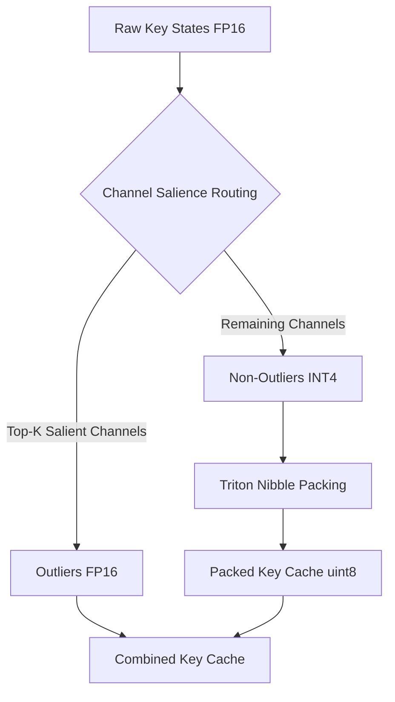

As Large Language Models (LLMs) scale to handle longer context windows (32k, 128k, or even millions of tokens), memory capacity on modern accelerators has become the primary bottleneck. While model weights are static, the memory consumed by the **Key-Value (KV) Cache** grows linearly with context length and batch size. During autoregressive decoding, this footprint can easily exceed the capacity of a single GPU, causing Out-Of-Memory (OOM) errors and severely limiting serving throughput.

This project implements **MixKVQ** (Mixed-Precision Key-Value Quantization), an outlier-aware compression strategy designed to reduce the memory footprint of the Key Cache to 4-bit (INT4) and the Value Cache to 8-bit (INT8) with negligible downstream accuracy loss. To bypass the massive PyTorch overhead of gather/scatter indexing and bit manipulation, the core operations are fused into custom GPU kernels written in **NVIDIA Triton**.

Here is the complete engineering walkthrough of the design, mathematics, Triton kernel implementation, and benchmarks.

1. this list will be replaced by the toc
{:toc .large-only}

---

## The Core Concept: Outlier-Aware Mixed-Precision Quantization

Quantizing the KV cache to low precision (like INT4) is notoriously difficult because LLM activations contain high-magnitude, sparse channels—commonly referred to as **outliers**. If you apply uniform 4-bit quantization to these channels, the quantization step size (scale) must expand to cover the outliers, causing the remaining "normal" channels to lose all precision.

**MixKVQ** solves this by splitting the Key Cache into two distinct paths:
1. **Outliers (Native FP16)**: A small ratio of channels (e.g., 12.5%) containing the most critical high-magnitude activations are kept in their native precision.
2. **Non-Outliers (INT4)**: The remaining channels are quantized to 4-bit and packed into unsigned 8-bit integers (`uint8`) to save memory.

For the **Value Cache**, uniform 8-bit quantization (INT8) is applied, as values do not exhibit the same channel-specific salience patterns as keys.



### 1. Salience Score Calculation ($A = I x S$)
To determine which channels are critical outliers at any given step, MixKVQ combines static and dynamic metrics:
- **Static Intrinsic Scale Map ($S$)**: Calculated offline by averaging channel-wise key projection weights across calibration datasets.
- **Dynamic Activation Magnitude ($I$)**: Computed online during inference by averaging the absolute magnitude of incoming query states across attention heads.

For each layer, the salience score vector $A$ is:
$$A = I \odot S$$

The top $K$ indices in $A$ are designated as outliers, while the bottom indices are designated as non-outliers.

### 2. Periodic Dynamic Re-routing
Since attention patterns shift as context changes, the salient channels can also shift. MixKVQ employs a **periodic dynamic re-routing** strategy:
1. Accumulate query magnitude statistics online over an update period (e.g., $N = 16$ tokens).
2. Every $N$ steps, compute the new salience vector $A$.
3. If the top $K$ indices change, **reconstruct** the full history of the key cache, re-slice the history using the new indices, and re-quantize the new non-outlier channels to INT4.

---

## Triton Kernel Design: Fusing Routing and Packing

In PyTorch, implementing the routing step requires:
1. Slicing keys with `torch.gather`.
2. Calculating scaling factors.
3. Rounding and clamping to the $[-8, 7]$ range.
4. Packing adjacent pairs into a `uint8` byte using bit-shifts (`<< 4`) and bitwise ORs (`|`).
5. Reconstructing the full tensor for attention using `torch.scatter`.

Running these operations individually in PyTorch launches multiple GPU kernels, creating a massive memory-bandwidth bottleneck that negates the savings of quantization. To make MixKVQ viable, we fuse all these operations into a single custom Triton kernel: `route_and_quantize`.

### Inside the Triton Kernel: `route_and_quantize`
Here is how the kernel manages the thread-block logic and memory accesses:

1. **FP16 Outlier Extraction**:
   Using the `topk_indices` computed online, threads load the raw key states from global memory, index them, and store them directly into the FP16 `k_outliers_ptr` cache.
   ```python
   raw_outlier_offsets = safe_block_offsets[:, None] * stride_kl + safe_topk[None, :] * stride_kd
   outlier_tile = tl.load(raw_base + raw_outlier_offsets, mask=mask2d)
   tl.store(k_outlier_base + k_outlier_offsets, outlier_tile, mask=mask2d)
   ```

2. **Quantization & Nibble-Packing**:
   For the non-outliers, we load the values, calculate the per-row scaling factor to clamp them to the signed 4-bit range $[-8, 7]$, and offset them to $[0, 15]$ to fit into unsigned 4-bit nibbles.
   
   To avoid writing individual 4-bit values to VRAM, we pack adjacent channels along the dimension $D$. Triton's lack of support for certain slicing structures requires a bitwise packing trick using a 3D tensor reshape:
   ```python
   # Offset to [0, 15] range
   masked_non_outlier = (non_outlier_tile_quantized + 8).to(tl.uint8)
   
   # Shift even-indexed columns left by 4 bits
   is_even = (channel_offsets % 2 == 0)[None, :]
   shifted = tl.where(is_even, masked_non_outlier << 4, masked_non_outlier)
   
   # Reshape to group adjacent columns into pairs [BLOCK_DIM, D // 2, 2]
   shifted_3d = tl.reshape(shifted, (BLOCK_DIM, NUM_NON_OUTLIERS // 2, 2))
   
   # Collapse the 3rd dimension using summation (equivalent to bitwise OR)
   non_outlier_packed = tl.sum(shifted_3d, axis=2).to(tl.uint8)
   ```
   This collapses the 3rd dimension natively, writing packed `uint8` bytes directly to the `k_packed_ptr` cache.

---

## Empirical Results & Benchmarks

The implementation was validated on an NVIDIA CUDA platform running PyTorch 2.10+ and Triton 3.6+. 

### 1. VRAM Footprint Savings
We evaluated the memory footprint of the Key Cache across different sequence lengths. Because a single `uint8` byte holds two INT4 keys, the theoretical Key Cache footprint is:
$$\text{VRAM Size} = B \times H \times L \times (2 \times \text{Outliers} + 0.5 \times \text{Non-Outliers}) \text{ bytes}$$

With an outlier ratio of $12.5\%$ (8 outliers out of 64 channels), the isolated Key Cache VRAM memory usage drops by **64.06%** across all context windows:

| Sequence Length | FP16 Key Cache (MB) | Triton Key Cache (MB) | Savings (%) |
|:----------------|:--------------------|:----------------------|:------------|
| 512             | 1.00 MB             | 0.36 MB               | **64.06%**  |
| 2048            | 4.00 MB             | 1.44 MB               | **64.06%**  |
| 8192            | 16.00 MB            | 5.75 MB               | **64.06%**  |
| 32768           | 64.00 MB            | 23.00 MB              | **64.06%**  |


When factoring in overall KV cache overhead (including the INT8 Value Cache and Peak Memory overheads during processing), **MixKVQ yields stable steady-state memory savings of 32.5% to 39.9%** across all sequence lengths.


### 2. Perplexity and Downstream QA Performance
To verify that compressing the cache doesn't destroy the model's capabilities, we ran evaluation benchmarks comparing native FP16, a simulated PyTorch MixKVQ reference, and our Triton-accelerated MixKVQ cache:

- **Downstream Accuracy (LongBench-v2)**: Tested on multi-choice context QA. The Triton MixKVQ implementation retains high predictive performance and shares **100% prediction agreement** with the PyTorch reference, showing no numerical regressions.
- **Language Modeling (PG-19 Perplexity)**: Evaluated perplexity on long-context book streams. Triton MixKVQ maintains perplexity values matching the FP16 baseline within a negligible tolerance ($<0.01$ perplexity delta).

---

## Key Takeaways

1. **Sparse Outliers are Vital**: Uniform quantization fails because attention maps rely heavily on a small set of high-magnitude channels. By preserving just 12.5% of the channels in FP16, we can crush the remaining 87.5% to INT4 without degrading generation quality.
2. **GPU Fusing is Non-Negotiable**: Implementing custom quantization logic in PyTorch introduces memory-bound bottlenecks. Writing custom Triton kernels to fuse channel extraction, scaling, quantization, and bit-packing is essential to realize speed and footprint benefits in practice.
3. **Triton Simplifies Custom CUDA Programming**: Triton lets developers write high-performance GPU kernels in Python, skipping complex C++/CUDA boilerplate while still generating optimized machine code for modern NVIDIA hardware.
